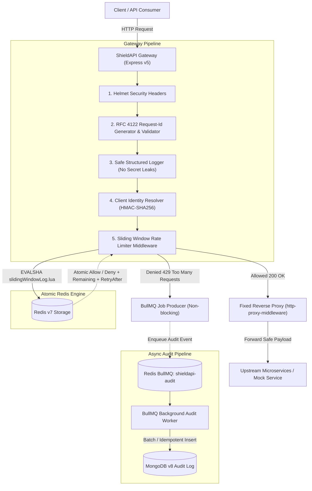

# ShieldAPI — Distributed API Gateway & Atomic Rate Limiter

[](https://nodejs.org/)
[](https://expressjs.com/)
[](https://redis.io/)
[](https://www.mongodb.com/)
[]()

ShieldAPI is a distributed, production-grade API gateway and rate-limiting system engineered in Node.js, Express, Redis, and MongoDB. It solves the classic Time-of-Check to Time-of-Use (**TOCTOU**) race conditions inherent in distributed rate limiters by executing an atomic sliding-window-log algorithm via an embedded **Lua script** directly inside Redis.

Accepted requests are reverse-proxied to fixed upstream microservices with timeout and header injection guards. Quota-exceeded requests are terminated with standard RFC `429 Too Many Requests` responses and enqueued asynchronously into **BullMQ**, keeping MongoDB persistence entirely off the gateway's real-time critical path.

---

## 1. High-Level Architecture



---

## 2. Key Engineering Features

- **Atomic Sliding Window Log (Zero TOCTOU Vulnerability):**
  Uses Redis `TIME`, `ZREMRANGEBYSCORE`, `ZCARD`, `ZADD`, and `PEXPIRE` inside a single Lua transaction. Multiple gateway instances share one exact sliding window without over-admission or under-admission.
- **Fail-Closed Resilience Policy:**
  If Redis crashes or becomes unreachable, the rate limiter instantly fails closed (`HTTP 503 Service Unavailable`), preventing downstream cascade outages.
- **Privacy & Cryptographic Identity Preservation:**
  Raw API keys, bearer tokens, and IP addresses are never stored in Redis keys, log lines, or MongoDB audit records. All identities are salted and hashed via `HMAC-SHA256` (`IDENTITY_HASH_SECRET`).
- **Decoupled Asynchronous Audit Pipeline:**
  Rate limit violations trigger non-blocking BullMQ jobs. MongoDB outages never impact the gateway's real-time latency or allow/deny decisions.
- **Optimized MongoDB Query Performance:**
  Compound B-tree indexing (`{ identityDigest: 1, occurredAt: -1 }`) achieves an index selectivity ratio of **1.00**, delivering a **22× reduction in disk document reads** during security investigations.
- **Fixed Upstream Reverse Proxying:**
  `http-proxy-middleware` strictly routes traffic to pre-configured upstream URLs with payload body limits (100kb), socket timeout isolation (HTTP 504), and error sanitization (HTTP 502), eliminating Server-Side Request Forgery (SSRF).

---

## 3. Technology Stack & Pinned Versions

| Component | Technology | Version | Purpose |
|---|---|---|---|
| **Runtime** | Node.js | `v22.12.0` (LTS) | Asynchronous non-blocking JavaScript engine |
| **Web Framework** | Express.js | `^5.3.0` | Gateway routing, middleware composition |
| **In-Memory Store** | Redis | `v7.0.15` / `ioredis ^6.0.0` | Atomic Lua rate limiting & BullMQ broker |
| **Audit Persistence** | MongoDB | `v8.2.0` / `mongoose ^9.11.4` | Durable audit log store with TTL & compound indexes |
| **Async Queue** | BullMQ | `^6.5.3` | Decoupled background violation processing |
| **Reverse Proxy** | `http-proxy-middleware` | `^3.0.10` | Stream forwarding to upstream microservices |
| **Security Headers** | `helmet` | `^8.3.0` | HSTS, frameguard, XSS filter, content-type sniffing |
| **Testing** | Jest + Supertest | `^30.5.2` / `^7.3.1` | Unit, concurrency, failure mode, and E2E testing |
| **Containerization** | Docker & Compose | Docker `28.5.1`, Compose `2.40.0` | Multi-container local reproducibility |

---

## 4. Quickstart & Setup

### Option A: Docker Compose (Recommended — One Command)

Prerequisites: [Docker Desktop](https://www.docker.com/) or Docker Engine installed.

```bash
# 1. Clone repository
git clone https://github.com/your-org/shieldapi.git
cd shieldapi

# 2. Build and start all 5 containers (redis, mongo, mock-upstream, gateway, audit-worker)
docker compose up --build

# 3. Verify gateway liveness and readiness
curl -i http://localhost:3000/health/live
curl -i http://localhost:3000/health/ready
```

To stop containers:
```bash
docker compose down
# Or to stop and delete persistent MongoDB volume:
docker compose down -v
```

---

### Option B: Local Node.js Development

Prerequisites: Node.js 22 LTS, Redis 7 (`localhost:6379`), MongoDB (`localhost:27017`).

```bash
# 1. Install dependencies
npm install

# 2. Create environment file from template
copy .env.example .env

# 3. Start the Gateway API server
npm start

# 4. In a separate terminal, start the asynchronous BullMQ audit worker
npm run worker
```

---

## 5. Environment Variables Reference

| Variable | Default Value | Required | Description |
|---|---|---|---|
| `PORT` | `3000` | No | Port on which the ShieldAPI gateway listens |
| `NODE_ENV` | `development` | No | Environment mode (`development`, `test`, `production`) |
| `UPSTREAM_BASE_URL` | `http://127.0.0.1:4001` | Yes | Target microservice base URL for allowed proxy traffic |
| `REDIS_URL` | `redis://127.0.0.1:6379` | Yes | Redis connection string for Lua limiter and BullMQ |
| `MONGODB_URI` | `mongodb://127.0.0.1:27017/shieldapi` | Yes | MongoDB URI for audit log persistence |
| `RATE_LIMIT_WINDOW_MS` | `60000` (60s) | No | Duration of the sliding-window log in milliseconds |
| `RATE_LIMIT_MAX_REQUESTS` | `5` | No | Maximum requests allowed per client in the sliding window |
| `RATE_LIMIT_FAIL_MODE` | `closed` | No | Failure mode on Redis outage: `closed` (503) or `open` |
| `RATE_LIMIT_IDENTITY_MODE`| `api-key-or-ip` | No | Client identifier: `api-key-or-ip`, `api-key`, or `ip` |
| `IDENTITY_HASH_SECRET` | *(string)* | Yes | Salt secret used to compute client HMAC-SHA256 digests |
| `PROXY_TIMEOUT_MS` | `5000` (5s) | No | Upstream target socket timeout before returning 504 |
| `AUDIT_RETENTION_DAYS` | `30` | No | TTL expiration days for audit log documents in MongoDB |

---

## 6. API Endpoints Reference

| Method | Endpoint | Auth | Purpose | Response Codes |
|---|---|---|---|---|
| `GET` | `/health/live` | None | Kubernetes liveness probe | `200 OK` |
| `GET` | `/health/ready` | None | Readiness probe (checks Redis, Mongo, Queue) | `200 OK`, `503 Service Unavailable` |
| `GET` | `/gateway/v1/catalog` | `X-API-Key` or IP | Proxied to upstream `/catalog` with rate limiting | `200 OK`, `429 Too Many Requests`, `503` |
| `GET` | `/gateway/v1/slow` | `X-API-Key` or IP | Proxied to upstream `/slow` (validates 504 timeout) | `200 OK`, `504 Gateway Timeout` |
| `POST`| `/gateway/v1/echo` | `X-API-Key` or IP | Proxied to upstream `/echo` (validates body streaming) | `200 OK`, `400 Bad Request` |
| `*` | `/*` | Any | Unmatched route handler | `404 Not Found` JSON |

### Rate Limit Response Headers (RFC Compliant)
Every protected gateway response returns standard diagnostic headers:
- `X-RateLimit-Limit`: Maximum requests permitted in the window (e.g. `5`).
- `X-RateLimit-Remaining`: Remaining request quota in the active sliding window.
- `X-RateLimit-Reset`: Unix epoch timestamp (seconds) when the earliest request leaves the window.
- `Retry-After`: Required on `429 Too Many Requests`; duration in whole seconds until retry is permitted.
- `X-Request-Id`: RFC 4122 UUID v4 assigned to the request.

---

## 7. Automated Testing Suite

ShieldAPI enforces a strict, zero-flake test suite verified with Jest and Supertest across 15 test suites and 59 automated test cases.

```bash
# Run all automated tests (unit + integration + failure modes + concurrency)
npm test
```

### Test Suite Breakdown

- **Unit Tests:**
  - `tests/unit/config.test.js`: Strict positive numeric validation, frozen config objects.
  - `tests/unit/requestId.test.js`: RFC 4122 UUID v4 validation and sanitization.
  - `tests/unit/errorHandler.test.js`: Centralized error normalization, stack trace striping.
  - `tests/unit/health.test.js`: Live and ready diagnostics.
  - `tests/unit/auditLog.model.test.js`: Mongoose schema validation, required fields, compound indexes.
  - `tests/unit/rateLimiter.service.test.js`: Parameter checking, window calculation.
  - `tests/unit/identifyClient.test.js`: API-key precedence, IP fallback, HMAC digest generation.
  - `tests/unit/auditWorker.test.js`: Worker retry policies, payload validation, idempotency.
- **Integration Tests:**
  - `tests/integration/rateLimiter.integration.test.js`: Live Redis Lua script execution, boundary tests.
  - `tests/integration/rateLimit.http.test.js`: Full HTTP pipeline, 200 headers, 429 Retry-After, zero secret leakage.
  - `tests/integration/gateway.proxy.test.js`: Allowed proxy forwarding, zero upstream hits on 429, 504 timeout, 502 bad gateway, SSRF injection protection.
  - `tests/integration/audit.e2e.test.js`: End-to-end 429 persistence via BullMQ into MongoDB.
  - `tests/integration/rateLimit.concurrency.test.js`: 50 concurrent requests against single and distributed gateways.
  - `tests/integration/failureModes.test.js`: Redis outage (503 fail-closed), MongoDB outage (degraded ready probe), BullMQ outage, upstream timeouts.
  - `tests/integration/mongo.smoke.test.js`: Live MongoDB insert, read, and cleanup.

---

## 8. Concurrency Proof & Performance Benchmarks

### 50-Request Concurrency Proof
To execute the automated concurrency test proving zero TOCTOU race conditions:

```bash
node scripts/concurrency-test.js
```
**Measured Output:**
```
Total Requests Dispatched:  50
Requests Allowed (200 OK): 10
Requests Denied (429):     40
Rate-Limit Invariant:      PASSED (Allowed count matched limit: 10)
Execution Duration:        167 ms
```

### Empirical Latency & Throughput Benchmark
Measured using `npm run benchmark` on a 12th Gen Intel Core i5-12450H (500 requests, Concurrency = 10):

| Scenario | Throughput | p50 Latency | p90 Latency | p95 Latency | p99 Latency |
|---|---|---|---|---|---|
| **Baseline (`/health/live`)** | 293.3 req/s | 28.72 ms | 53.26 ms | 85.49 ms | 104.78 ms |
| **Gateway Allowed (`/gateway/v1/catalog`)** | 85.4 req/s | 90.02 ms | 239.05 ms | 342.42 ms | 384.28 ms |
| **Gateway Rate-Limited (`429 Denied`)** | 180.2 req/s | 42.75 ms | 95.90 ms | 116.70 ms | 307.63 ms |

> [!TIP]
> Notice that rate-limited requests (429) run **~2.1× faster** than allowed requests. Because quota denial short-circuits before the reverse proxy hop and enqueues to BullMQ asynchronously, over-quota traffic relieves downstream server load instantly.

See [`docs/BENCHMARKS.md`](file:///c:/Users/samay/OneDrive/Desktop/SheildAPI/docs/BENCHMARKS.md) for full benchmark logs, MongoDB query execution plans, and bottleneck analysis.

---

## 9. Known Limitations & Production Considerations

1. **Memory Growth of Sliding Window Log:**
   The sliding-window-log algorithm stores one entry per request inside a Redis Sorted Set (`ZSET`). For high-throughput public APIs (e.g. 100,000 req/sec per client), a **Token Bucket** or **Sliding Window Counter** consumes less memory (`O(1)` memory vs `O(N)` where N is requests in window). ShieldAPI uses Sliding Window Log for absolute precision and burst protection.
2. **Single Redis Instance vs. Redis Cluster:**
   The current Lua script is optimized for standalone Redis or Redis Sentinel. In a multi-master Redis Cluster, keys must include a hash tag (e.g. `{client_digest}`) to ensure all timestamps for a single client hash to the same cluster shard.
3. **Clock Drift Across Distributed Gateways:**
   The Lua script uses Redis's internal clock (`redis.call('TIME')`) as the source of truth, avoiding clock drift across different gateway machines. However, if Redis itself has an unsynced clock, TTLs may vary slightly relative to client wall-clock time.

---

## 10. Engineering Resume Highlights

- **Distributed Rate Limiting:** Designed and implemented a Redis-backed sliding-window rate limiter using atomic Lua scripts (`TIME`, `ZREMRANGEBYSCORE`, `ZCARD`, `ZADD`, `PEXPIRE`) to guarantee zero race conditions across distributed gateway instances.
- **Concurrency & Correctness Verification:** Built automated multi-instance concurrency suites testing 50 simultaneous requests against a shared Redis quota, proving exact boundary admission (10 allowed, 40 denied in 167ms).
- **Asynchronous Reliability Pipeline:** Decoupled security violation audit logging from the request hot path using BullMQ and MongoDB; eliminated database bottlenecks and maintained fail-closed (503) gateway availability during infrastructure outages.
- **Database Query Optimization:** Engineered compound indexing (`{ identityDigest: 1, occurredAt: -1 }`) on MongoDB audit records, reducing examined documents from 2,221 to 101 (**22× I/O reduction**) verified via `explain("executionStats")`.
